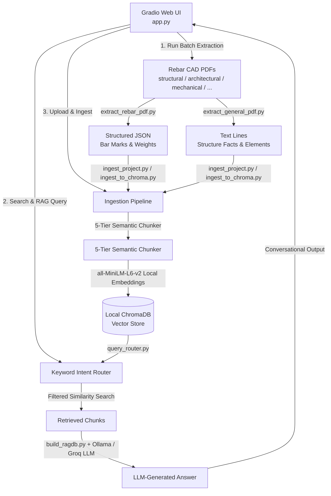

# Salit Steel — Rebar Estimator Agent (Construct AI)

Welcome to the **Salit Steel Rebar Estimator Agent** project! This repository contains a local-first, offline Python pipeline designed to extract rebar (reinforcement steel) quantities directly from drawing vector PDFs (without OCR), deduplicate bars across drawings, generate highly optimized structured RAG (Retrieval-Augmented Generation) chunks, ingest them into ChromaDB, and enable natural language semantic querying for estimators — complete with fully offline LLM-generated answers via a local [Ollama](https://ollama.com) model (no API key required).

Additionally, this repository contains a generic spatial reconstruction tool to extract complex rebar schedules into formatted Excel workbooks.

---

## 📋 Table of Contents
1. [Problem Statement](#-problem-statement)
2. [Pipeline Architecture](#-pipeline-architecture)
3. [File Inventory](#-file-inventory)
4. [Environment Setup (Python 3.12)](#-environment-setup-python-312)
5. [Running the Pipeline](#-running-the-pipeline)
    - [Step 1: Batch Process PDFs via pdf_list.txt](#step-1-batch-process-pdfs-listed-in-pdf_listtxt)
    - [Step 2: Single PDF Ingestion & Querying](#step-2-single-pdf-ingestion--querying)
    - [Step 3: Batch Ingesting to ChromaDB](#step-3-batch-ingesting-to-chromadb)
    - [Step 4: Running Natural Language Queries](#step-4-running-natural-language-queries)
    - [Step 5: N-Document Project Ingestion](#step-5-n-document-project-ingestion-any-number-of-pdfs-any-doc_type)
    - [Step 6: Query with Routing + LLM Answer Generation](#step-6-query-with-routing--llm-answer-generation)
    - [Step 7: End-to-End Pipeline Test](#step-7-end-to-end-pipeline-test)
    - [Step 8: Extracting Bar Lists directly to Excel](#step-8-extracting-bar-lists-directly-to-excel)
6. [Chunk Types Reference](#-chunk-types-reference)
7. [Query Routing](#-query-routing)
8. [QC and Deduplication Strategy](#-qc-and-deduplication-strategy)

> **⚠️ Before extending or debugging extraction, read [KNOWN_LIMITATIONS.md](KNOWN_LIMITATIONS.md).**
> It documents two source-document constraints that are **not** pipeline bugs:
> (1) per-element bar/member **length is not extractable** from these drawings, so
> MTO/weight can't be computed; (2) the **steel↔concrete schedule mis-anchoring**
> failure mode (steel members absorbing concrete rebar) and the reusable
> `classify_member` guard that prevents it.

---

## 🔍 Problem Statement

Estimators at Salit Steel manually inspect structural drawing sets (PDFs) and extract rebar quantities to create quotes. This process suffers from:
* **Time-Consuming Extraction**: Manual tabulation takes hours per drawing set.
* **The Double-Counting Problem**: The same bar mark often appears in plan, section, and elevation views, causing estimators to count the same steel multiple times, which inflates estimates and quotes.
* **Data Silos**: Past estimates are not searchable, and there is no unified retrieval system for estimators to lookup details across projects.

---

## ⚙️ Pipeline Architecture

This project solves the above problems using a multi-stage local pipeline:


### Stage 1 — Vector PDF Extraction & Deduplication (`extract_rebar_pdf.py`)
* **Vector Parsing**: Directly accesses PyMuPDF's vector line segment and text span layer—no slow or inaccurate OCR required.
* **Unit System Parsing**: Interprets Canadian metric bar sizes (`10M`, `15M`, `20M`, `25M`, `30M`, `35M`) and converts imperial lengths (e.g. `2'-6"`) to linear meters.
* **Linear Weights**: Applies standard Canadian unit weights (e.g., `15M = 1.570 kg/m`) to compute weight per bar and total tonnage.
* **Deduplication**: Automatically groups identical bar marks across drawing sheets, retaining the entry with the most complete attributes (quantity, length, size) and discarding duplicate occurrences in other views.

### Stage 1b — General Drawing Extraction (`extract_general_pdf.py`)
* **Universal PDF Parser**: Extracts text, dimensions, structure facts (material, storeys, area, foundation type, roof type), and structural element records (footings, beams, columns, piers, slabs) from any drawing type — architectural, mechanical, civil-site, etc.
* **Attribute Extraction**: Parses element attributes including spacing, cover, lap length, stock length, hook length, stirrups, ties, rebar count, shape type, and cross-section size via targeted regex patterns.
* **Reusable APIs**: `extract_structure_facts()` and `extract_elements()` are also called by the structural parser to enrich rebar drawings with high-level metadata.

### Stage 2 — Semantic Chunking & Vector Ingestion
The extracted data is split into **five semantic chunk types** in ChromaDB, matched to estimator lookup behaviors:

| Chunk Type | Granularity | Best For |
|---|---|---|
| `structure_overview` | One per project, aggregated across all docs | Material, storeys, area, foundation/beam/column/roof types; conflicts across revisions recorded in metadata. |
| `element_summary` | One per structural element (footing, beam, column, pier, slab) | Granular element queries: "how many 20M bars in column CL1?", "cover on footing F1". |
| `project_summary` | One per project | Aggregate weights, unique bar marks after cross-document dedup, bar sizes referenced. |
| `pdf_detail` | One per PDF / sheet revision | Sheet-specific bar count, weight breakdown by size, QC reference verification. |
| `size_row` | One per bar size per drawing sheet | Granular size lookups: "quantity of 15M bars on drawing B1", unit weight queries. |

### Stage 3 — Keyword Intent Routing (`query_router.py`)
A lightweight keyword scorer maps each natural-language query to the most relevant `chunk_type(s)` and optionally narrows by `doc_type` or `source_doc_id` discovered live from the collection's metadata (open set — no hardcoded document names). Falls back to unfiltered similarity search when no intent matches.

### Stage 4 — Local Semantic Query Interface + LLM Generation (`build_ragdb.py`)
Uses the `all-MiniLM-L6-v2` embedding model (runs completely local on CPU) to embed both the chunks and user queries. Cosine similarity queries are executed against ChromaDB to find matching records. Retrieved chunks are then forwarded to a **local LLM via Ollama** (`qwen3:14b` by default) to produce a natural-language answer instead of raw chunk text — fully offline, no API key. An optional Groq cloud backend is available via `--backend groq`.

---

## 🗃️ File Inventory

| File / Folder | Purpose |
|---|---|
| [app.py](file:///d:/MinoriLabs-intern/Connstruct_ai_assitant/Construct_ai_PyMuPDF/app.py) | Conversational Web interface for querying, PDF ingestion, and running pipelines. |
| [run.py](run.py) | Main runner script at the root. Reads PDFs from `input/pdf_list.txt`, runs the extractor on them, prints summaries, and outputs JSON files to `output/`. |
| [input/](input/) | Input folder where PDFs to be processed should be placed. |
| [input/pdf_list.txt](input/pdf_list.txt) | List file where you can paste the file names of the PDFs you want to extract (one per line). |
| [output/](output/) | Output folder where all extracted structured JSON outputs are automatically saved. |
| [src/](src/) | Contains the core implementation scripts: |
| &nbsp;&nbsp;├─ [extract_rebar_pdf.py](src/extract_rebar_pdf.py) | Extracts drawing text, line vectors, and rebar schedule tables to a structured JSON representation. Includes bar-mark deduplication and Canadian unit weight conversion. |
| &nbsp;&nbsp;├─ [extract_general_pdf.py](src/extract_general_pdf.py) | General-purpose drawing extractor for non-structural PDFs. |
| &nbsp;&nbsp;├─ [ingest_to_chroma.py](src/ingest_to_chroma.py) | Batch ingests pre-extracted drawing records into the main RAG database. |
| &nbsp;&nbsp;├─ [ingest_project.py](src/ingest_project.py) | N-document project ingestion routing to the right parser. |
| &nbsp;&nbsp;├─ [build_ragdb.py](src/build_ragdb.py) | Unified query interface running retrieve → route → generate pipeline. |
| &nbsp;&nbsp;├─ [query_router.py](src/query_router.py) | Keyword intent router mapping queries to chunk types. |
| &nbsp;&nbsp;├─ [test_pipeline.py](src/test_pipeline.py) | End-to-end test generating synthetic PDFs and testing the pipeline. |
| &nbsp;&nbsp;└─ [inspect_bars.py](src/inspect_bars.py) | Helper script for inspecting bar mark context within drawing text. |
| [requirements.txt](requirements.txt) | Python package dependencies for setup. |
| [rebar-barlist-extractor/](rebar-barlist-extractor/) | Generic CRSI/CSA spatial layout reconstructor for rotated schedules. |
| [test_docs/](test_docs/) | Auto-generated synthetic PDFs created by `test_pipeline.py`. |
| [salit_chroma_db/](salit_chroma_db/) | Persisted local ChromaDB vector store (created on first ingest). |

---

## 🛠️ Environment Setup (Python 3.12)

This project has been set up with a Python 3.12 virtual environment (`.venv`) to isolate all packages locally on your Windows machine.

### 1. Creation & Activation
A `.venv` virtual environment is initialized. To activate it in PowerShell, run:
```powershell
.venv\Scripts\Activate.ps1
```

### 2. Dependencies Installation
The packages in `requirements.txt` can be installed via:
```powershell
pip install -r requirements.txt
```
*Packages include:*
- `pymupdf` — PDF vector and text parsing
- `chromadb` — local vector database
- `sentence-transformers` + `torch` — local `all-MiniLM-L6-v2` embedding model (CPU)
- `pandas` & `openpyxl` — Excel utilities for the bar-list extractor
- `ollama` — client for locally-hosted LLM answer generation (default backend)
- `python-dotenv` — loads `.env` config (MODEL, OLLAMA_HOST, …)
- `groq` — optional cloud LLM backend (`--backend groq`)

### 3. Local LLM via Ollama (for Answer Generation)
Answer generation runs on a **local model through [Ollama](https://ollama.com)** — no API key, no data leaves the machine. Any query using `--query` without `--no-generate` uses it.

1. **Install & start Ollama** (leave it running):
   ```powershell
   ollama serve
   ```
2. **Pull the default model** (one-time, ~9 GB):
   ```powershell
   ollama pull qwen3:14b
   ```
3. **Confirm it's available:**
   ```powershell
   ollama list        # qwen3:14b must appear
   ```
4. **(Optional) choose a different local model** via the `MODEL` env var — it takes a local Ollama tag, not a cloud model string:
   ```powershell
   $env:MODEL = "qwen3:14b"          # default
   # $env:MODEL = "qwen3:8b"         # faster, weaker
   # $env:MODEL = "qwen3-coder:30b"  # code-tuned, strongest at tables, slowest
   $env:OLLAMA_HOST = "http://localhost:11434"  # optional; this is the default
   ```

If Ollama isn't running or the model isn't pulled, generation fails gracefully and the query falls back to printing the raw retrieved chunks (with a warning) — it never crashes.

**Optional cloud fallback (Groq):** pass `--backend groq` and set `GROQ_API_KEY` (and `MODEL` to a Groq model string like `llama-3.3-70b-versatile`). Ollama is the default.

---

## 🚀 Running the Pipeline

### Step 1: Batch Process PDFs listed in pdf_list.txt
To extract vector data from multiple PDF drawings at once:
1. Copy or move your drawing PDFs into the `input/` folder.
2. Edit **[input/pdf_list.txt](input/pdf_list.txt)** to add the PDF file names (one per line). Absolute paths are also supported.
3. Run the main runner script:
   ```bash
   python run.py
   ```
   This will process every PDF listed in `pdf_list.txt`, print detailed summaries (including bar schedules with sizes, counts, spacing, and annotations), and save structured JSON files (e.g., `filename_extracted.json`) directly into the `output/` folder.

   *Optional runner flags:*
   - `--verbose`: Includes full raw text block coordinates in the output logs.
   - `--no-json`: Skips saving the `.json` output files in the `output/` directory (prints console summaries only).
   - `--list <custom_list_path>`: Uses a custom list file instead of the default `input/pdf_list.txt`.

### Step 2: Single PDF Ingestion & Querying
Once you have the JSON file in `output/`, you can ingest it directly into ChromaDB:
```bash
python src/build_ragdb.py --input "output/drawing_name_extracted.json"
```
Or process and ingest a PDF directly in one step:
```bash
python src/build_ragdb.py --pdf "input/drawing_name.pdf"
```
Query the single PDF database:
```bash
python src/build_ragdb.py --query "total weight of B1 bars"
```

### Step 3: Batch Ingesting to ChromaDB
To build the complete `salit_steel_rebar` database of 93 documents (aggregating all 23 drawings), batch ingest the pre-processed `qc_results.json`:
```bash
python src/ingest_to_chroma.py --ingest
```

### Step 4: Running Natural Language Queries
Query the main multi-project database:
```bash
# Query total weight of 15M bars across all projects
python src/ingest_to_chroma.py --query "total weight of 15M bars across all projects"

# Query bar sizes used in LARCA MACHINING
python src/ingest_to_chroma.py --query "all bar sizes in LARCA MACHINING"

# Get drawing revision info
python src/ingest_to_chroma.py --query "latest revision for DUNVEGAN"
```

### Step 5: N-Document Project Ingestion (any number of PDFs, any doc_type)
Ingest 1..N PDFs for one project under a shared `project_id`. Each `--doc` flag is
`doc_type:path` — doc_type is free text (`structural`, `architectural`, `mechanical`,
`civil-site`, ...). Structural docs get rebar/bar-mark parsing; everything else goes
through the general text/dimension extractor. New categories only need a parser
registered in `PARSER_REGISTRY` in `src/ingest_project.py`.
```bash
python src/ingest_project.py --project "DUNVEGAN" ^
    --doc structural:"path/to/structural.pdf" ^
    --doc architectural:"path/to/architectural.pdf" ^
    --doc mechanical:"path/to/mechanical.pdf"
```
This adds two chunk types alongside the existing three: `structure_overview`
(one per project, aggregated across all docs, conflicts recorded in metadata)
and `element_summary` (one per beam/footing/pier/column/slab). Every chunk
carries `project_id`, `doc_type`, `source_doc_id`, `chunk_type`, `chunk_id`.

Re-ingesting a project replaces all its existing chunks automatically (idempotent upsert).

### Step 6: Query with Routing + LLM Answer Generation
`src/build_ragdb.py --query` runs the full retrieve → route → generate pipeline.
Keyword routing filters by `chunk_type` (and `doc_type` / `source_doc_id` when the
question names one); the retrieved chunks are sent to a **local LLM via Ollama**
(see Setup step 3) and a natural-language answer is printed instead of raw chunks.
```powershell
# Ensure Ollama is running (ollama serve) and the model is pulled (ollama pull qwen3:14b)
$env:MODEL = "qwen3:14b"   # optional; this is the default (a local Ollama tag)

# Query the project-level (N-doc) DB
python src/build_ragdb.py --query "how many storeys does the structure have" --db salit

# Force the raw-chunk path (no LLM), or use the optional cloud backend
python src/build_ragdb.py --query "how many piers" --db salit --no-generate
python src/build_ragdb.py --query "how many piers" --db salit --backend groq

# Restrict to one drawing type
python src/build_ragdb.py --query "spacing for 15M bars" --db salit --doc-type structural

# Restrict to one specific document
python src/build_ragdb.py --query "cover on footing F1" --db salit --source-doc-id DUNVEGAN_S1_R01.pdf

# Raw chunks only — no LLM call
python src/build_ragdb.py --query "total weight of B1 bars" --no-generate
```

### Step 7: End-to-End Pipeline Test
Generates 3 synthetic PDFs (2 structural including a revision + 1 architectural),
ingests them as one project, and runs one query per estimation stage (6 total)
through the full retrieve → route → generate pipeline. Conflict detection is also
exercised (the two structural revisions carry different storey counts):
```bash
python src/test_pipeline.py
```

### Step 8: Extracting Bar Lists directly to Excel
For structural drawings where the bar schedule is rotated 90 degrees or has no gridlines, run the spatial reconstruction skill to produce a 3-sheet Excel report containing the Bar List, Title Block, and Unmapped Text:
```bash
python rebar-barlist-extractor/scripts/extract_rebar_dwg.py "path_to_drawing.pdf" "output_report.xlsx"
```

### Step 9: Conversational Web Interface (Gradio App)
For a premium, local-first interactive dashboard to run queries, ingest files, and monitor the pipeline:
1. Ensure Ollama is running (`ollama serve`) and the default model is pulled (`ollama pull qwen3:14b`).
2. Run the Gradio application script:
   ```bash
   python app.py
   ```
   *Note: Startup is optimized to launch instantly (under 1s) and fallback to the next open port (e.g. 7861, 7862) automatically if port 7860 is occupied.*
3. Open **[http://127.0.0.1:7860](http://127.0.0.1:7860)** in your web browser.
4. UI Features:
   - **🔍 Estimator Chat Agent**: Conversational chat area displaying multi-turn history. Expand the collapsible *View Sources & Routing Info* toggle under each AI answer bubble to inspect matching document chunks and scoring details. Configure the database (`rebar` vs `salit`), LLM backend, top-K, and doc filters dynamically in the collapsed *Advanced Settings* panel.
   - **📥 Ingest Drawing Document**: Upload PDF drawings (structural, architectural, mechanical, civil-site, general) or pre-extracted JSON files. Execute validations/dry-runs to audit accepted/rejected elements. Monitor real-time logs.
   - **⚙️ Pipeline & Database Inspector**: Tweak `input/pdf_list.txt` contents, launch `run.py` batch pipeline with streamed stdout outputs, and refresh collection stats/chunk counts.

---

## 📐 Chunk Types Reference

| Chunk Type | ID Pattern | Key Metadata Fields |
|---|---|---|
| `structure_overview` | `overview__{project_id}` | `material`, `storeys`, `total_area`, `foundation_type`, `beam_type`, `column_type`, `roof_type`, `structure_contents`, `conflicts` |
| `element_summary` | `el__{project_id}__{element_type}__{label}` | `element_type`, `label`, `size`, `count`, `num_rebars`, `rebar_size`, `shape_type`, `stirrups`, `spacing`, `cover`, `lap_length`, `stock_length`, `hook_length`, `ties_type`, `ties_length`, `doc_type`, `source_doc_id` |
| `project_summary` | `proj__{project_id}` | `project`, `doc_count`, `bar_marks`, `sizes` |
| `pdf_detail` | `pdf__{project_id}__{source_doc_id}` | `project`, `file`, `doc_type`, `source_doc_id` |
| `size_row` | `size__{project_id}__{source_doc_id}__{size}` | `project`, `file`, `size`, `doc_type`, `source_doc_id` |

All chunks also carry the standard metadata fields: `project_id`, `chunk_type`, `chunk_id`, `doc_type`, `source_doc_id`, `seq`.

---

## 🔀 Query Routing

`src/query_router.py` performs lightweight keyword/intent scoring before every ChromaDB query. It maps the natural-language question to the most relevant `chunk_type(s)` and optionally further narrows results by `doc_type` or `source_doc_id`:

| Intent Keywords (examples) | Routes to |
|---|---|
| "storeys", "floors", "material", "total area", "foundation type", "overview" | `structure_overview` |
| "beams", "footings", "columns", "cover", "stirrups", "lap length", "hook" | `element_summary` |
| "15M", "bar size", "unit weight", "spacing for 20M" | `size_row` |
| "revision", "R01", "document", ".pdf", "on sheet" | `pdf_detail` |
| "total weight", "across all", "summary", "whole project" | `project_summary` |

- `doc_type` and `source_doc_id` filters are discovered dynamically from the live collection metadata (open set — no hardcoded names).
- When a filtered search returns no results, the router automatically falls back to an unfiltered similarity search.

---

## 🎯 QC and Deduplication Strategy
* **Variance Validation**: The pipeline's deduplication logic is validated against the reference BIRGE CARNEGIE Excel sheets:
  * **R01**: 0.00% weight variance.
  * **R02**: 0.02% weight variance.
  * **R03**: 0.00% weight variance.
* **Cross-Document Deduplication**: `src/ingest_project.py` deduplicates bar marks across all structural documents in a project (not just pairs), retaining the bar entry with the most complete attribute set per mark.
* **Conflict Detection**: When `structure_overview` chunks are built from multiple document revisions with conflicting values (e.g., different storey counts), the conflicts are recorded in the chunk's `conflicts` metadata field for downstream review.
* **Unmapped Text Safeguard**: Spans not consumed by the parser are placed in the `Unmapped Text` sheet of the Excel extraction, ensuring metadata (like stamp details or custom notes) is never lost.