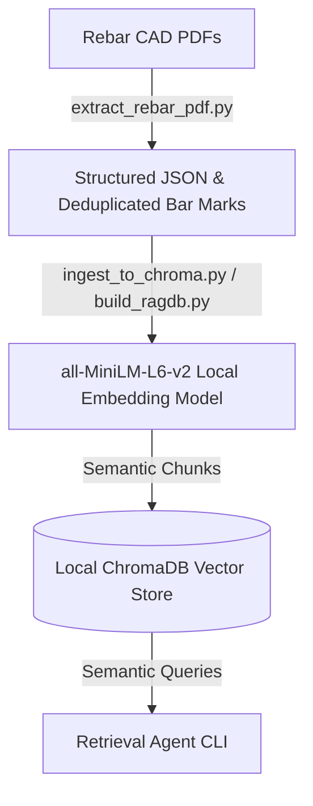

# Salit Steel — Rebar Estimator Agent (Construct AI)

Welcome to the **Salit Steel Rebar Estimator Agent** project! This repository contains a local-first, offline Python pipeline designed to extract rebar (reinforcement steel) quantities directly from drawing vector PDFs (without OCR), deduplicate bars across drawings, generate highly optimized structured RAG (Retrieval-Augmented Generation) chunks, ingest them into ChromaDB, and enable natural language semantic querying for estimators.

Additionally, this repository contains a generic spatial reconstruction tool to extract complex rebar schedules into formatted Excel workbooks.

---

## 📋 Table of Contents
1. [Problem Statement](#-problem-statement)
2. [Pipeline Architecture](#-pipeline-architecture)
3. [File Inventory](#-file-inventory)
4. [Environment Setup (Python 3.12)](#-environment-setup-python-312)
5. [Running the Pipeline](#-running-the-pipeline)
    - [Step 1: Extract PDF Vector Data to JSON](#step-1-extract-pdf-vector-data-to-json)
    - [Step 2: Single PDF Ingestion & Querying](#step-2-single-pdf-ingestion--querying)
    - [Step 3: Batch Ingesting to ChromaDB](#step-3-batch-ingesting-to-chromadb)
    - [Step 4: Running Natural Language Queries](#step-4-running-natural-language-queries)
    - [Step 5: Extracting Bar Lists directly to Excel](#step-5-extracting-bar-lists-directly-to-excel)
6. [QC and Deduplication Strategy](#-qc-and-deduplication-strategy)

---

## 🔍 Problem Statement

Estimators at Salit Steel manually inspect structural drawing sets (PDFs) and extract rebar quantities to create quotes. This process suffers from:
* **Time-Consuming Extraction**: Manual tabulation takes hours per drawing set.
* **The Double-Counting Problem**: The same bar mark often appears in plan, section, and elevation views, causing estimators to count the same steel multiple times, which inflates estimates and quotes.
* **Data Silos**: Past estimates are not searchable, and there is no unified retrieval system for estimators to lookup details across projects.

---

## ⚙️ Pipeline Architecture

This project solves the above problems using a two-stage local pipeline:


### 1. Vector PDF Extraction & Deduplication (`extract_rebar_pdf.py`)
* **Vector Parsing**: Directly accesses PyMuPDF’s vector line segment and text span layer—no slow or inaccurate OCR required.
* **Unit System Parsing**: Interprets Canadian metric bar sizes (`10M`, `15M`, `20M`, `25M`, `30M`, `35M`) and converts imperial lengths (e.g. `2'-6"`) to linear meters.
* **Linear Weights**: Applies standard Canadian unit weights (e.g., `15M = 1.570 kg/m`) to compute weight per bar and total tonnage.
* **Deduplication**: Automatically groups identical bar marks across drawing sheets, retaining the entry with the most complete attributes (quantity, length, size) and discarding duplicate occurrences in other views.

### 2. Semantic Chunking & Vector Ingestion
We split the extracted data into three semantic layers in ChromaDB to match estimator lookup behaviors (rather than arbitrary token counts):
| Chunk Type | Granularity | Best For |
|---|---|---|
| `project_summary` | One per project | Aggregate weights, overall revisions, and total list of bar sizes used. |
| `pdf_detail` | One per PDF / sheet revision | Sheet-specific bar count, weight breakdown by size, and QC reference verification. |
| `size_row` | One per size per drawing sheet | Granular lookups (e.g., "Find quantity of 15M bars on drawing B1"). |

### 3. Local Semantic Query Interface
Uses the `all-MiniLM-L6-v2` embedding model (runs completely local on CPU) to embed both the chunks and user queries. Cosine similarity queries are executed against ChromaDB to find matching records instantly.

---

## 🗃️ File Inventory

| File / Folder | Location | Purpose |
|---|---|---|
| [extract_rebar_pdf.py](file:///d:/MinoriLabs-intern/Construct_ai_PyMuPDF/extract_rebar_pdf.py) | Root | Extracts drawing text, line vectors, and tables to a structured JSON representation. |
| [build_ragdb.py](file:///d:/MinoriLabs-intern/Construct_ai_PyMuPDF/build_ragdb.py) | Root | Single-file utility to parse a PDF (or load extracted JSON) and query its local Chroma collection. |
| [ingest_to_chroma.py](file:///d:/MinoriLabs-intern/Construct_ai_PyMuPDF/ingest_to_chroma.py) | Root | Batch ingests pre-extracted drawing records from `qc_results.json` into the main RAG database using the three-tier chunking structure. |
| [requirements.txt](file:///d:/MinoriLabs-intern/Construct_ai_PyMuPDF/requirements.txt) | Root | Python package dependencies for setup. |
| [rebar-barlist-extractor/](file:///d:/MinoriLabs-intern/Construct_ai_PyMuPDF/rebar-barlist-extractor) | Root Subfolder | Generic CRSI/CSA spatial layout reconstructor that outputs directly to Excel sheets. |

---

## 🛠️ Environment Setup (Python 3.12)

This project has been set up with a Python 3.12 virtual environment (`.venv`) to isolate all packages locally on your Windows machine.

### 1. Creation & Activation
A `.venv` virtual environment is initialized. To activate it in PowerShell, run:
```powershell
.venv\Scripts\Activate.ps1
```

### 2. Dependencies Installation
The packages in `requirements.txt` can be installed via:
```powershell
pip install -r requirements.txt
```
*Note: This includes `pymupdf` (for PDF processing), `chromadb` (vector database), `sentence-transformers` (local embeddings), `pandas` & `openpyxl` (for Excel utilities).*

---

## 🚀 Running the Pipeline

### Step 1: Extract PDF Vector Data to JSON
Run the vector extractor on a drawing PDF to output its structured coordinates, annotations, and initial schedules:
```bash
python extract_rebar_pdf.py "path_to_drawing.pdf" --output json
```
This produces a `path_to_drawing_extracted.json` file in the same directory.

### Step 2: Single PDF Ingestion & Querying
Ingest a drawing's JSON structure directly into ChromaDB:
```bash
python build_ragdb.py --input "path_to_drawing_extracted.json"
```
Or process and ingest a PDF directly:
```bash
python build_ragdb.py --pdf "path_to_drawing.pdf"
```
Query the single PDF database:
```bash
python build_ragdb.py --query "total weight of B1 bars"
```

### Step 3: Batch Ingesting to ChromaDB
To build the complete `salit_steel_rebar` database of 93 documents (aggregating all 23 drawings), batch ingest the pre-processed `qc_results.json`:
```bash
python ingest_to_chroma.py --ingest
```

### Step 4: Running Natural Language Queries
Query the main multi-project database:
```bash
# Query total weight of 15M bars across all projects
python ingest_to_chroma.py --query "total weight of 15M bars across all projects"

# Query bar sizes used in LARCA MACHINING
python ingest_to_chroma.py --query "all bar sizes in LARCA MACHINING"

# Get drawing revision info
python ingest_to_chroma.py --query "latest revision for DUNVEGAN"
```

### Step 5: Extracting Bar Lists directly to Excel
For structural drawings where the bar schedule is rotated 90 degrees or has no gridlines, run the spatial reconstruction skill to produce a 3-sheet Excel report containing the Bar List, Title Block, and Unmapped Text:
```bash
python rebar-barlist-extractor/scripts/extract_rebar_dwg.py "path_to_drawing.pdf" "output_report.xlsx"
```

---

## 🎯 QC and Deduplication Strategy
* **Variance Validation**: The pipeline's deduplication logic is validated against the reference BIRGE CARNEGIE Excel sheets:
  * **R01**: 0.00% weight variance.
  * **R02**: 0.02% weight variance.
  * **R03**: 0.00% weight variance.
* **Unmapped Text Safeguard**: Spans not consumed by the parser are placed in the `Unmapped Text` sheet of the Excel extraction, ensuring metadata (like stamp details or custom notes) is never lost.